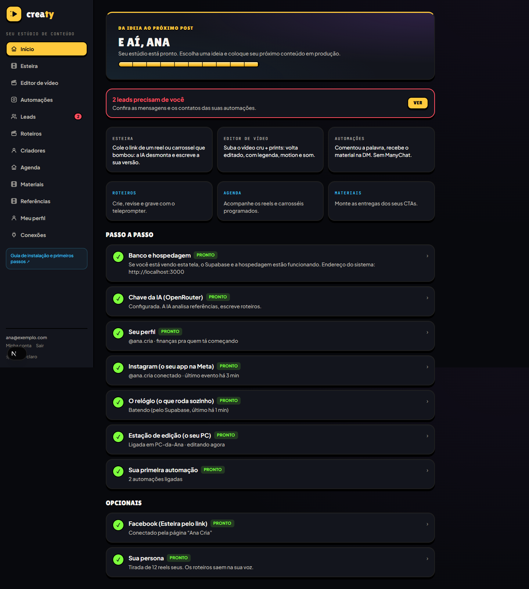

# Creaty

Seu estúdio de conteúdo: da referência ao post, nas suas contas e com a sua identidade. Código aberto sob a [licença MIT](LICENSE).

O **guia dentro do sistema** fica em **Guia de instalação e primeiros passos**, no menu lateral (`/guia`). O Início acompanha o estado das conexões e da instalação.



## Funcionalidades

- Referências por link, vídeo ou prints; análise do formato e versões na sua voz.
- Roteiros por tema, arquivo ou referência, com revisão, histórico e padrão viral personalizável.
- Monitoramento de criadores do Instagram e YouTube, com limites configuráveis. Começa desligado.
- Teleprompter e gravação de takes pelo navegador, com cortes, velocidade, ajustes e música.
- Editor de vídeo com estilos, estação local, revisão e aprovação.
- Carrosséis completos, com sua foto e assinatura, produzidos por estação local.
- Publicação de reels e carrosséis pela API do Instagram, com agenda em horário de Brasília.
- Páginas de materiais para CTAs: prompts, links, templates e passos.
- Automações de comentário → DM, com botão, verificação de seguidor e entrega do material.

WhatsApp, disparos e agentes de atendimento da operação interna ficam fora desta distribuição. As CLIs usadas pelas estações produzem conteúdo; não atendem leads no direct.

## Requisitos

Node.js **22.18+**, npm, um projeto Supabase exclusivo para a instalação e hospedagem Next.js (Vercel ou VPS). A análise de mídia usa uma chave OpenRouter. As integrações exigem Instagram profissional e seu próprio app Meta.

Para produzir localmente, veja [editor/INSTALAR.md](editor/INSTALAR.md): FFmpeg, Whisper, modelo de transcrição e CLI de IA instalada e autenticada. Custos, limites e recursos disponíveis dependem dos provedores e dos seus planos.

## Instalação local

Na pasta da sua cópia do repositório, rode `npm ci`. Copie `.env.example` para `.env.local` e preencha:

```dotenv
NEXT_PUBLIC_SUPABASE_URL=https://SEU-PROJETO.supabase.co
NEXT_PUBLIC_SUPABASE_PUBLISHABLE_KEY=SUA-CHAVE-PUBLICA
SUPABASE_SECRET_KEY=SUA-CHAVE-SECRETA
```

Rode `npm run dev` e abra `http://localhost:3000`. No primeiro acesso, o login oferece o **SQL completo de instalação**. Execute no SQL Editor do Supabase, volte e crie a conta do dono. A chave secreta comprova que você controla a instalação: nunca publique essa chave nem use um prefixo `NEXT_PUBLIC_` para ela.

As tabelas ficam em `public`, com RLS e autorização em `criador_privado`. Use um banco exclusivo para o Creaty.

Alternativa: configure `DATABASE_URL` com a conexão Postgres do Supabase e rode `npm run migrar`. Continue usando o mesmo método nas atualizações: o migrador registra os arquivos aplicados; SQL executado manualmente não cria esse histórico.

## Vercel

1. Faça um fork e importe o repositório como projeto Next.js.
2. Configure as três variáveis do Supabase e faça o deploy.
3. Abra a instalação, aplique o SQL e crie a conta do dono.
4. No Início, configure IA, perfil e Instagram.
5. Ative `pg_cron` e `pg_net` no Supabase e use **Ligar relógio** no Início.

Mudou variáveis na hospedagem? Faça outro deploy. Confira se o plano atende ao seu uso e aos tempos de execução. As estações de produção rodam no computador, fora da Vercel.

## Docker / VPS

```sh
docker build -t creaty --build-arg NEXT_PUBLIC_SUPABASE_URL=https://SEU-PROJETO.supabase.co --build-arg NEXT_PUBLIC_SUPABASE_PUBLISHABLE_KEY=SUA-CHAVE-PUBLICA .
docker run --env-file .env.local -p 3000:3000 creaty
```

Acrescente `APP_URL=https://seu-endereco` e `RELOGIO=ligado` ao ambiente do servidor. Use HTTPS e uma réplica para o relógio interno. `/api/health` é o healthcheck. Chaves secretas nunca entram nos argumentos de build.

O download de alguns links depende de `yt-dlp` instalado no servidor (`YTDLP_BIN`). Sem ele, envie o arquivo pelo navegador. O Docker inclui o baixador. A disponibilidade da mídia também depende da rede de origem.

## Instagram e conexões

Siga o **Início** e **Conexões** para configurar seu app Meta, token, segredo e webhook. Confira as permissões para comentários, mensagens e publicação de conteúdo conforme o login escolhido. O app precisa estar apto a atender as contas da instalação.

Para importar referências e monitorar perfis de terceiros, conecte também o Facebook à conta profissional. Algumas contas, músicas e mídias não são liberadas pela API: use o envio por arquivo.

## Estações no computador

Veja [editor/INSTALAR.md](editor/INSTALAR.md) e prepare também o navegador dos carrosséis:

```sh
npx playwright install chromium
npm run estacao -- --preparar
```

Abra **três terminais**, na pasta do projeto:

| Comando | Função |
| --- | --- |
| `npm run estacao` | Edição de vídeo, takes e render |
| `npm run roteiro:estacao` | Roteiros, legendas e materiais |
| `npm run carrossel:estacao` | Produção e render dos carrosséis |

A primeira estação pergunta endereço do sistema, e-mail e senha. As outras reutilizam a sessão do dono e a RLS; não é necessário fornecer a chave secreta ao computador.

No Editor, escolha quem edita. A escrita local aceita Claude ou Codex; o motor OpenRouter do editor é independente. O botão explícito **Gerar pela API** gera roteiros sem esperar a estação. Deixe as estações ligadas durante a produção; arquivos já agendados são publicados pelo servidor.

## Primeiro conteúdo

1. Preencha **Meu perfil** com nome, @, nicho, público, tom e cores.
2. Adicione uma **Referência** ou crie um **Roteiro**. Personalize **Roteiros → Padrão viral**.
3. Grave pelo navegador ou use o teleprompter com seu gravador habitual.
4. Na **Esteira**, escolha a edição, revise e aprove a publicação.
5. Para carrosséis, envie todos os slides, confira a ordem, produza e revise antes de agendar.
6. Revise o material do CTA em **Materiais** e confira os posts na **Agenda**.

## Atualização

Faça backup do banco, atualize sua cópia e rode `npm ci`. Aplique as migrações novas em ordem e refaça o deploy. Para quem já tinha a versão inicial, esta atualização usa `supabase/migrations/002_producao.sql`. Não reaplique migrações antigas pelo migrador se elas foram executadas manualmente sem registrar o histórico.

Atualize também as estações no computador. Oficinas e resultados ficam fora do Git: preserve-os se precisar ajustar produções anteriores.

## Demonstração e verificações

```sh
npm run demo                  # localhost:3100, dados fictícios, sem persistência
npm run typecheck
npm run lint
npm run build
npm run reels:testar
npm run automacoes:testar
npm run carrossel:verificar
```

Os testes de render precisam de Chromium do Playwright e FFmpeg no PATH. Não usam contas reais nem publicam no Instagram.

Se a versão nova trouxer tabela nova no banco (um arquivo novo em `supabase/migrations`, como `004_carrossel.sql`), o **Início** avisa e mostra o SQL pra copiar: cole no **SQL Editor** do Supabase e clique em **Run** (1 minuto; pode rodar de novo sem medo, não estraga nada). Quem roda o sistema pelo terminal pode usar `npm run migrar`.

## Problemas comuns

| Problema | Confira |
| --- | --- |
| Banco vazio ou área nova não abre | SQL / migração `002_producao.sql` |
| Pedido parado | Estação correspondente e autenticação da CLI |
| Referência ou monitor sem avançar | Chave da IA, Facebook e relógio |
| Link não baixa | Mídia disponível e `yt-dlp`; envie o arquivo como alternativa |
| Post não sai | Erro na Agenda, relógio e permissões de publicação |
| Publicação interrompida | Confira no Instagram antes de retomar para evitar duplicação |
| Webhook não verifica | URL pública, token e segredo no Início |

## Desenvolvimento

Next.js, React, TypeScript, Tailwind e Supabase. Leia [CLAUDE.md](CLAUDE.md) e [AGENTS.md](AGENTS.md). Evolua o banco com migrações novas. Não distribua `.env.local`, sessões, contatos ou arquivos pessoais.

Criado por **Lucas Duty**. [Licença MIT](LICENSE).
